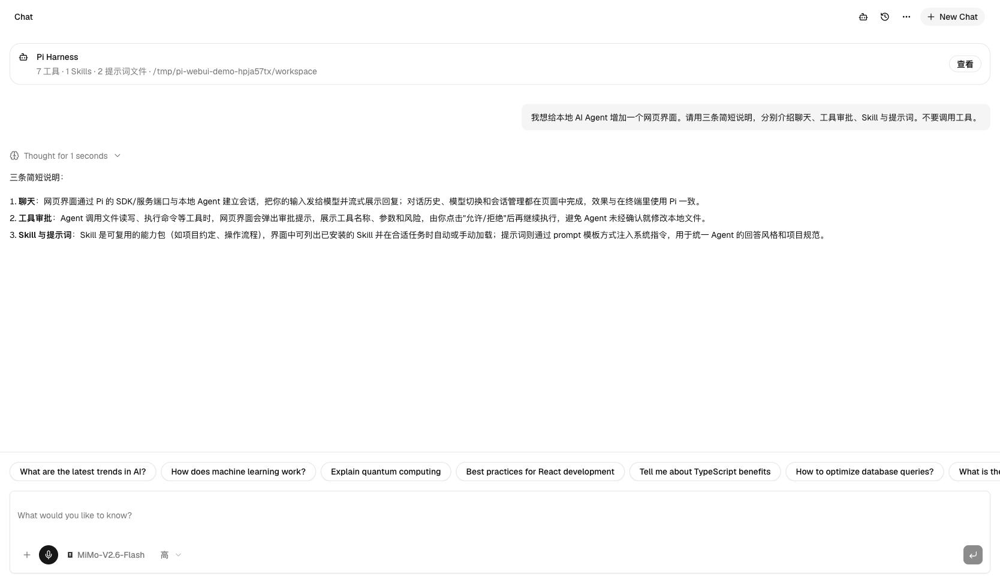

# 本地 Agent WebUI

通过官方 AI SDK Harness 接入本机 Pi Agent 的聊天工作台。主界面复用 [AI Elements Chatbot 示例](https://elements.ai-sdk.dev/examples/chatbot) 的原组件、布局和默认主题。

[教程目录](docs/README.md) · [阅读完整图文教程](docs/tutorial/本地-Agent-WebUI-搭建教程.md)



## 运行

当前案例使用 Node.js 24.16.0；Pi 要求 Node.js 22.19 或更高版本。

如果尚未配置 Pi，可以先执行：

```bash
npm install --global --ignore-scripts @earendil-works/pi-coding-agent@1.4.0
pi
```

在 Pi 中使用 `/login` 连接供应商、`/model` 选择模型，并先验证一次对话。已有 Pi 配置可以直接复用，无需复制认证文件或在网页中再次填写密钥。

在本案例目录执行：

```bash
npm ci
mkdir -p demo-workspace
```

可创建 `.env.local`，将 Agent 工作目录设为演示目录：

```dotenv
PI_WEB_WORKSPACE=./demo-workspace
PI_WEB_DATA_DIR=.data
```

启动网页：

```bash
npm run dev
```

访问 http://127.0.0.1:3000 。端口占用时使用 `npm run dev -- --port 3001`。

生产运行：

```bash
npm run build
npm start
```

## 已接入能力

- Pi 本机供应商、认证、可用模型与每个模型支持的思考档位。
- 流式消息、Markdown、代码块、推理、附件、语音输入与明暗主题。
- 真实文件和 Shell 工具、人工批准与拒绝、工具输入与输出。
- Skills 发现、原文预览、按需读取和 `/skill:name` 显式调用。
- AGENTS 上下文、SYSTEM 与 APPEND_SYSTEM 加载，区分预览和实际运行提示词。
- 浏览器聊天历史及服务重启后的 Pi 原生上下文恢复。

联网搜索未配置时隐藏对应入口；来源仅在实际返回时展示。文本/代码和支持模型的图片可发送，每次最多 4 个文件，每个 4 MB；PDF 等二进制文档没有通用解析。语音输入取决于浏览器能力与授权。

MCP 配置可显式传给 Pi 适配器，但真实 MCP 服务的接入与调用需要使用者单独验证。Pi CLI 的扩展包、主题和命令模板不会整套自动运行。

## 配置

| 变量 | 默认值与用途 |
| --- | --- |
| `PI_CODING_AGENT_DIR` | 默认 `~/.pi/agent`，指定已有 Pi 配置目录 |
| `PI_WEB_WORKSPACE` | 默认当前启动目录，设置 Agent 操作的项目目录 |
| `PI_WEB_DATA_DIR` | 默认 `.data`，保存应用拥有的会话状态 |
| `PI_WEB_SKILL_DIRS` | 可选；只从指定目录发现 Skills，macOS/Linux 多目录以冒号分隔 |

更多说明见 [.env.example](.env.example)。供应商密钥和原始认证只在服务端读取。

网页默认只监听本机回环地址。这里的 `local-sandbox` 是**本机文件与进程执行适配**，不提供容器或操作系统隔离；工具继承服务进程的权限和环境。模型计算位置由供应商端点决定。

## 数据与会话

浏览器可见历史保存在当前站点的 localStorage；恢复状态保存在 `.data/sessions/`。Pi 原生会话文件还位于 `~/.ai-sdk/harness-pi/` 中，并镜像到对应应用会话目录。

固定使用相同浏览器和地址续聊。不同端口、`localhost` 与 `127.0.0.1` 各自拥有浏览器历史；本案例没有跨浏览器扫描所有磁盘会话的入口。当前会话互斥面向单 Node 进程。

## 核心文件

| 文件 | 职责 |
| --- | --- |
| [chat.tsx](src/components/chat.tsx) | 当前聊天入口和消息流绑定 |
| [pi-config.ts](src/lib/pi-config.ts) | 读取并拆分公开模型元数据与内部配置 |
| [pi-session.ts](src/lib/pi-session.ts) | Harness 会话创建、恢复和持久化 |
| [local-sandbox.ts](src/lib/local-sandbox.ts) | 真实文件与进程执行 |
| [harness-resources.ts](src/lib/harness-resources.ts) | Skill、提示词与 MCP 配置加载 |
| [chat route](src/app/api/chat/route.ts) | 输入、审批与 UI 消息流 |

## 验证

```bash
npm run typecheck
npm test
npm run verify:ui
npm run build
```

测试用隔离目录与本地模拟模型服务执行真实官方 Harness 链路，不消耗个人供应商配额。教学截图来自独立演示实例的实际供应商调用与本机工具执行；它们不替代所有供应商、移动端或 MCP 的完整验收。

完整操作步骤见 [教程目录](docs/README.md)，组件清单、原始快照与校验方式见 [组件来源说明](docs/references/components.md)。上游授权位于 `third_party/`。
