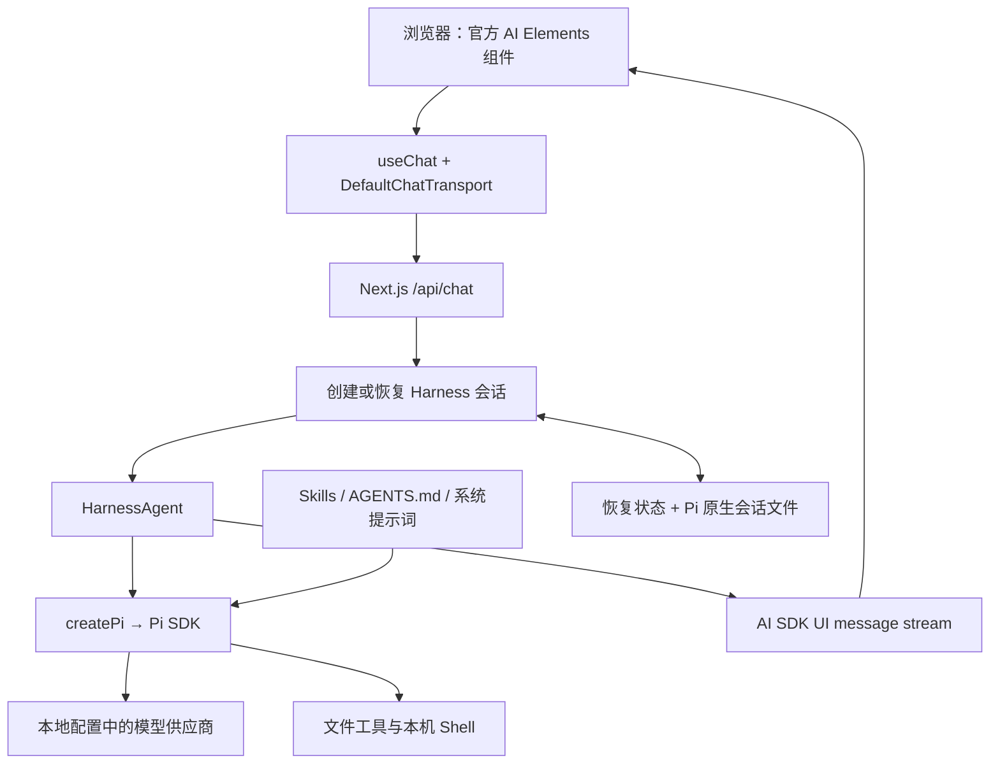
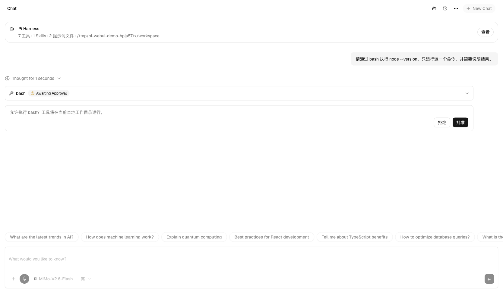
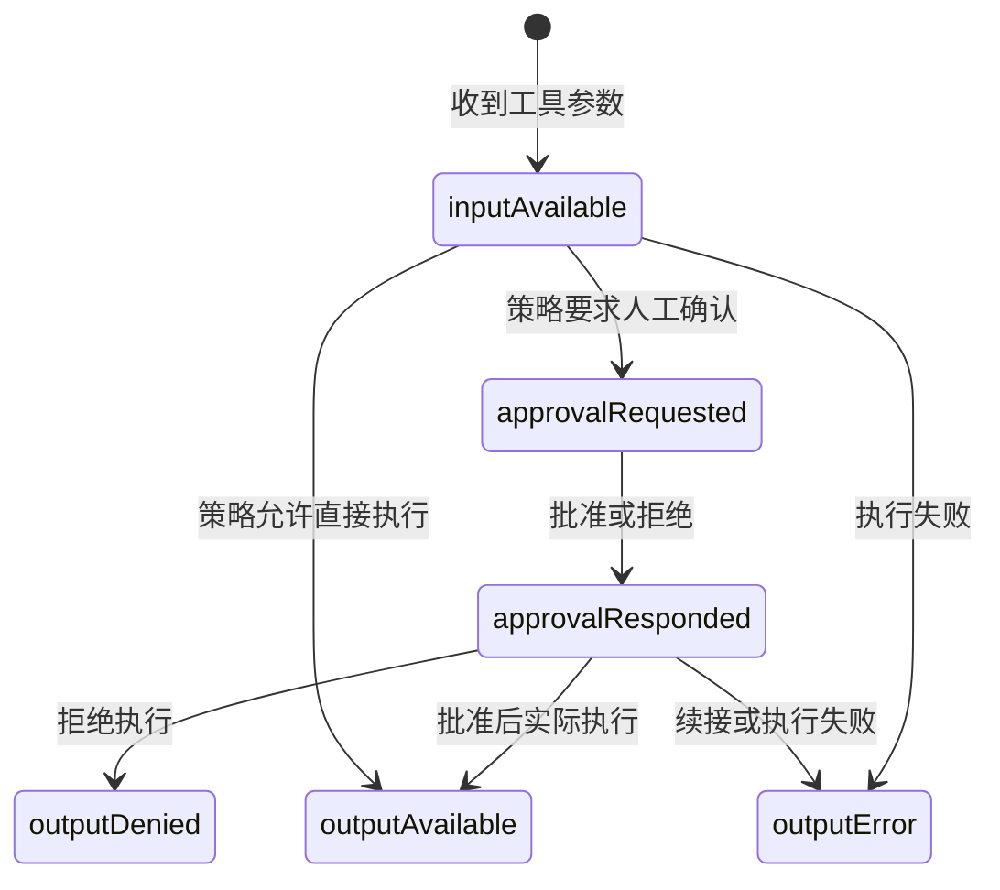
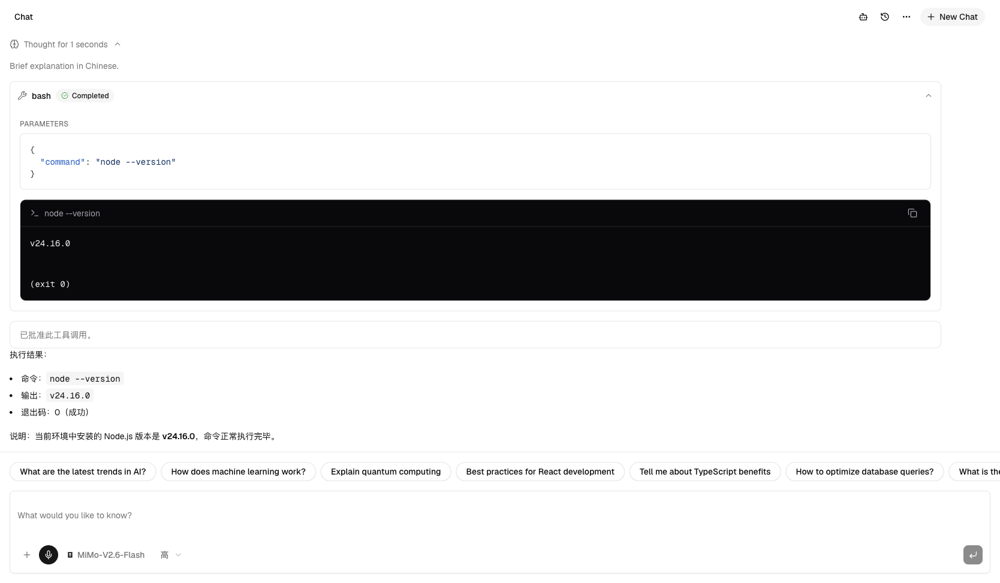
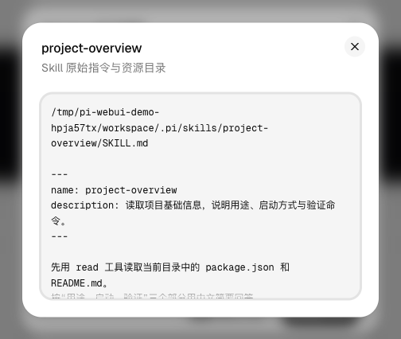
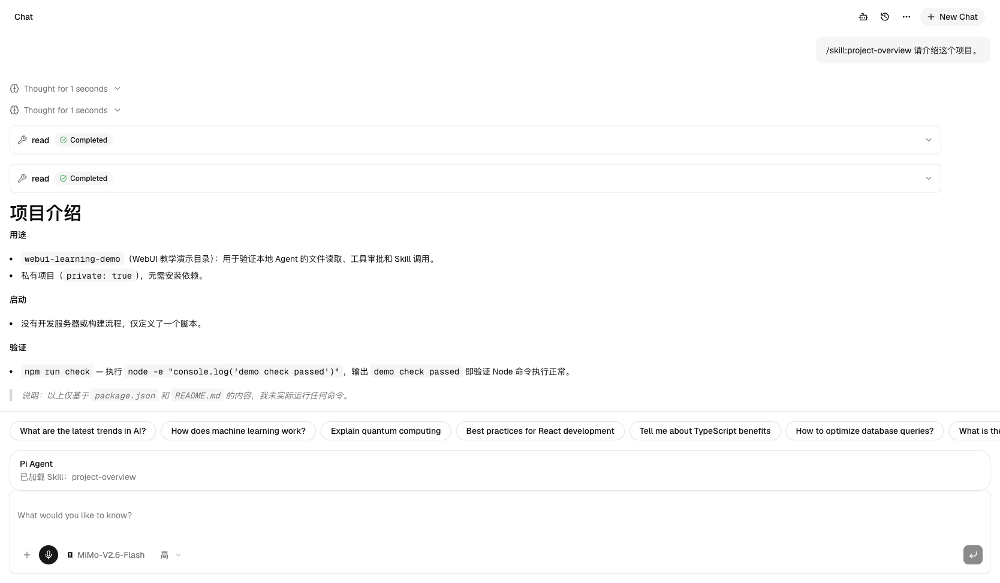
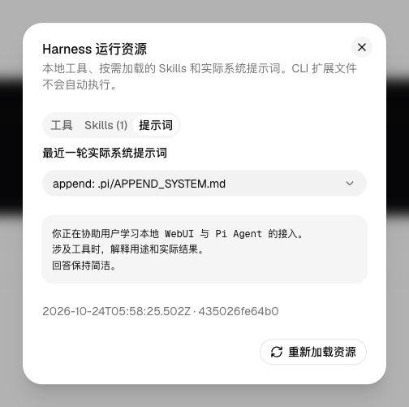

# 给本地 AI Agent 装上 WebUI：用官方组件和 Pi Harness 搭建完整聊天工作台

# 一、背景介绍：我们要做出什么

在终端里使用 AI Agent 时，你可以让它回答问题、读取项目文件和运行命令。但如果想在浏览器里查看对话、搜索模型、批准工具调用，还需要为它增加一个网页界面。

接下来，我们会搭建一个在本机运行的聊天网站：你可以切换已有模型和思考强度，查看流式回复与工具执行结果，在命令执行前批准或拒绝，并加载自己的 Skill 和项目提示词。关闭页面或重启服务后，还可以继续原来的对话。


*图 1：先看最终运行效果。顶部提供会话与资源操作，中间显示真实对话，底部集中放置附件、模型、思考档位与发送按钮。后面会按阶段接通这些能力。*

截图来自本机启动的演示实例，使用临时工作目录与教学文件；模型回复由已配置的供应商实际返回。你的模型名称、回复内容和临时路径可能不同。

最终效果包括：

| 能力 | 完成后的行为 |
| --- | --- |
| 聊天界面 | 流式消息、Markdown、代码块、思考过程、附件、模型搜索、思考强度、明暗主题 |
| Agent 执行 | Pi 决定何时读取文件、运行命令；网页展示真实工具输入、输出和错误 |
| 人工审批 | 需要批准的调用先暂停，用户批准或拒绝后继续原回合 |
| 资源与恢复 | 查看 Skills 和提示词来源，显式调用 Skill；刷新页面和重启服务后继续同一原生会话 |

这篇教程采用“先运行，再按模块搭建和验证”的方式。你需要能执行终端命令，阅读少量 TypeScript 和 React 代码；不熟悉的部分可以使用各阶段给出的提示词，让开发 AI 协助完成。

# 二、依赖介绍：先认识各层的职责

## 2.1 界面、通信和 Agent 分别由谁负责

| 依赖 | 在网站中的职责 |
| --- | --- |
| Next.js 与 React | 提供网页、前端交互和本机 API 服务 |
| shadcn/ui 与 AI Elements | 提供现成的聊天、输入、模型选择、工具与审批组件 |
| Tailwind CSS | 应用这些组件自带的布局和主题样式 |
| AI SDK 与 `useChat` | 在浏览器和服务端之间传递流式消息及工具状态 |
| AI SDK Harness | 管理 Agent 会话、执行事件和审批续接，为不同 Agent 提供统一接入方式 |
| Pi Agent 与 Pi Harness 适配器 | 使用本机已有的供应商、模型和认证，实际执行任务 |
| Node.js | 运行 Web 服务，并为本教程提供文件和 Shell 执行能力 |

**Pi** 是本教程选用的 AI Agent；**Harness** 是连接网页和 Agent 的接入层；**Skill** 是 Agent 可加载的一份任务说明及其配套资源。先记住这三个角色，后面会分别实现它们的配置、连接和展示。

## 2.2 当前服务使用的版本

| 依赖 | 版本 |
| --- | --- |
| Node.js | 24.16.0 |
| Next.js / React | 16.4.2 / 19.3.1 |
| AI SDK / React hook | `ai` 7.0.150 / `@ai-sdk/react` 4.0.154 |
| Harness / Pi adapter | `@ai-sdk/harness` 1.0.161 / `@ai-sdk/harness-pi` 1.0.163 |
| Pi SDK / 模型能力库 | `@earendil-works/pi-coding-agent` 1.4.0 / `@earendil-works/pi-ai` 1.4.0 |
| Tailwind CSS | 4.3.3 |

配套源码中的 `package.json` 和 `package-lock.json` 已包含完整依赖，安装时使用 `npm ci`。

## 2.3 理解一轮对话的连接关系



用户发送消息后，网页通过本机 API 找到对应的 Harness 会话，再由 Pi 调用所选模型。模型需要使用工具时，执行结果继续回到同一个会话，最后以流式消息显示在页面中。[参考：Harness UI 接入](https://ai-sdk.dev/docs/ai-sdk-harnesses/ui)。

这里嵌入的是 Pi SDK，并不控制一个已打开的终端窗口。网页会复用 CLI 的配置和认证，但拥有自己的对话会话。

本地运行也有两个具体边界：模型是否在本机计算由供应商端点决定；本教程的工具直接使用本机文件系统与 Shell，不提供容器隔离。默认只监听本机回环地址，供本人使用。

# 三、搭建过程：从本地启动到完整运行

每个阶段都以上一步的结果为起点。先完成目标和检查，再继续增加能力。

| 阶段 | 本阶段增加什么 | 进入下一阶段前检查什么 |
| --- | --- | --- |
| 一：启动本地服务 | 环境、认证、配套代码与工作目录 | 终端 Pi 可用，网页能打开 |
| 二：搭建聊天界面 | 官方组件、主题与页面骨架 | 界面结构正确，输入和滚动可用 |
| 三：接入模型配置 | 真实模型列表与思考档位 | 页面选择与本机配置一致 |
| 四：打通对话与恢复 | Harness 会话、API、前端流与历史 | 能回复，刷新和重启后能继续 |
| 五：接入工具与审批 | 工具卡片、批准、拒绝与停止 | 执行过程和审批结果可核对 |
| 六：加载 Skill 与提示词 | 资源发现、显式调用和来源展示 | 能依据 Skill 读取文件并回答 |
| 七：完成验收与运行 | 自动检查、浏览器验证与生产启动 | 完整流程通过，失败能定位 |

## 阶段一：准备环境，启动本地服务

**目标**：让终端中的 Pi 能回答问题，并在本机打开网页。准备好的工作目录会用于后面的工具和 Skill 练习。

### 步骤 1：安装 Pi 并完成认证

已经配置好 Pi 的读者可以跳过安装步骤。第一次使用时：

```bash
node --version
npm install --global --ignore-scripts @earendil-works/pi-coding-agent@1.4.0
pi
```

进入 Pi 后，使用 `/login` 连接你有权限使用的供应商，通过 `/model` 选择模型；思考档位可在 `/settings` 中设置。先发送一句话，确认供应商确实能返回结果。相关入口和认证方式见 [Pi 官方说明](https://github.com/earendil-works/pi/tree/main/packages/coding-agent)。具体交互以安装的 1.4.0 版本为准。

默认配置目录是：

```text
~/.pi/agent/
├── settings.json       默认模型、思考档位与资源设置
├── models.json         自定义供应商、端点与模型定义
├── models-store.json   模型目录缓存（如存在）
└── auth.json           凭证
```

不用把 `auth.json` 复制到项目里，也不用再在网页里填写一次密钥。Web 服务以当前用户身份在服务端读取这些配置。

### 步骤 2：安装网页依赖并配置工作目录

从 [Agent 教程案例仓库](https://github.com/MiJack/agent-tutorial-samples) 获取代码，进入本教程对应的案例目录：

```bash
git clone https://github.com/MiJack/agent-tutorial-samples.git
cd agent-tutorial-samples/local-agent-webui
npm ci
mkdir -p demo-workspace
```

如果你已经下载或克隆了仓库，直接进入 `local-agent-webui` 后执行后两条命令。下文中的“项目根目录”均指这个案例目录。

为了让初次练习只针对演示目录，在项目根目录创建 `.env.local`：

```dotenv
PI_WEB_WORKSPACE=./demo-workspace
PI_WEB_DATA_DIR=.data
# 已有 Pi 配置通常不需要设置这一项：
# PI_CODING_AGENT_DIR=/absolute/path/to/.pi/agent
```

其他可选环境变量如下。已有配置可保持默认，只设置演示工作目录即可：

| 变量 | 作用 |
| --- | --- |
| `PI_WEB_WORKSPACE` | Agent 操作的项目目录；默认是 Web 服务启动目录 |
| `PI_WEB_DATA_DIR` | 应用会话数据目录；默认 `.data` |
| `PI_CODING_AGENT_DIR` | Pi 配置目录；默认 `~/.pi/agent`，显式配置时使用绝对路径 |
| `PI_WEB_SKILL_DIRS` | 如设置，则只从指定目录发现 Skills；macOS/Linux 多目录用冒号分隔 |

然后启动：

```bash
npm run dev
```

访问 `http://127.0.0.1:3000`。端口被占用时，使用 `npm run dev -- --port 3001`，并访问对应端口。

此时先确认 `http://127.0.0.1:3000` 能打开，不出现依赖或路由错误。模型认证、界面结构与 Agent 行为将在后续阶段分别检查。

案例目录包含全部实现。下面按搭建顺序讲解各模块：运行时可随时对照完整文件；独立重做时，可用每节提示词让开发 AI 实现该阶段。代码块标注为“节选”的，不要单独覆盖为整个文件。

### 步骤 3：准备后续练习要读取的文件

创建 `demo-workspace/package.json`：

```json
{
  "name": "webui-learning-demo",
  "private": true,
  "scripts": {
    "check": "node -e \"console.log('demo check passed')\""
  }
}
```

创建 `demo-workspace/README.md`：

```markdown
# WebUI 教学演示目录

这是一个用于验证 Agent 文件读取与 Skill 调用的目录。
无需安装依赖。使用 npm run check 验证 Node 命令执行。
```

### 步骤 4：找到接下来要修改的模块

先认识几个文件，后面的步骤会反复用到它们：

```text
src/
├── app/
│   ├── layout.tsx                 字体、主题、全屏容器
│   ├── globals.css                官方主题与 Tailwind 扫描
│   ├── page.tsx                   在服务端读取公开模型信息
│   └── api/
│       ├── config/route.ts        模型目录与默认项
│       ├── chat/route.ts          输入、审批与消息流
│       ├── harness/route.ts       工具、Skills、提示词来源
│       └── chats/[id]/route.ts    删除应用拥有的会话数据
├── components/
│   ├── chat-app.tsx               页面入口
│   ├── chat.tsx                   当前实际使用的对话界面
│   ├── harness-tool.tsx           工具输出与批准/拒绝
│   ├── harness-panel.tsx          Tools / Skills / Prompts 面板
│   ├── ai-elements/               指定 Chatbot 示例的原组件
│   │   └── ui/                    与原组件匹配的 Radix 依赖
│   └── ui/                       顶部和资源面板的官方基础组件
├── hooks/use-chat-workspace.ts    浏览器中的会话与页面状态
└── lib/
    ├── pi-config.ts              Pi 模型配置适配
    ├── pi-session.ts             原生会话生命周期和持久化
    ├── local-sandbox.ts          本机文件与进程执行适配
    ├── harness-resources.ts      Skills、上下文、提示词、MCP
    ├── chat-input.ts             文本和附件转换
    ├── request.ts                请求与会话 ID 校验
    └── types.ts                  前后端公开类型
```

阅读页面时，沿 `chat-app.tsx → chat.tsx` 这条实际调用链进入。`scripts`、`docs/references/ui/upstream` 和 `third_party` 分别保存校验脚本、组件快照与授权，后续来源检查会用到它们。

### 可交给 AI 的提示词

```text
请先阅读当前版本文档与配套工程，确认模型认证、原生会话、审批、Skill 和执行环境的接口。
安装依赖并配置独立的 demo-workspace，不复制个人认证文件。
验证终端 Pi 能回答问题，网页能在 127.0.0.1 打开。
按界面、模型配置、会话、API、资源加载的职责列出文件位置。
修改 Next.js 代码前阅读 node_modules/next/dist/docs 中对应版本的说明。
```

**完成标志**：终端 Pi 能正常回答；网页能打开；`demo-workspace` 中有供后续读取的 `package.json` 和 `README.md`。下一步只处理界面。

## 阶段二：复用官方组件，搭出聊天界面

**目标**：在已启动的页面中确定组件、布局、字体和主题，让后续功能接入时有稳定的显示位置。

### 步骤 1：取得示例组件及其匹配依赖

界面采用 [AI Elements Chatbot 示例](https://elements.ai-sdk.dev/examples/chatbot)。原 AI Elements 正在迁移到 shadcn/ui，新旧组件命名与组织方式有所变化；迁移关系见 [shadcn AI Elements 文档](https://ui.shadcn.com/docs/ai-elements)。

配套代码保存了这个示例的原组件、匹配的基础依赖和示例源码。业务代码替换的是模型数据、事件和传输方式，组件本身的样式保持来源版本。

| 页面区域 | 直接复用的官方组件 |
| --- | --- |
| 消息和滚动 | Conversation、Message、MessageResponse、ConversationScrollButton |
| 推理与来源 | Reasoning、Sources |
| 输入与附件 | PromptInput、Attachments、SpeechInput |
| 模型和建议 | ModelSelector、Suggestions |
| 工具与审批 | Tool、Terminal、Confirmation |
| 资源查看 | Dialog、Tabs、Command、Item、CodeBlock、ScrollArea |

配套代码保留两个 `ui` 目录：指定示例依赖 Radix 风格的组件接口，而部分管理控件来自另一个官方 Base UI 版本。两者都有“Select”“Dialog”，属性却不完全相同。隔离依赖，可以避免把 `asChild` 和 `render` 等不同接口混在一起。

初次复现建议直接使用案例目录中的组件和快照。未来若从官网重新安装组件，先核对新版本 API、依赖与视觉，再更新业务适配；不要一边重装 `latest`，一边承诺外观与本文完全一致。

### 步骤 2：组合页面骨架并加载主题

`src/components/chat.tsx` 的结构可以简化为下面这样。**这是布局节选**，其中的 `messages`、事件和状态由阶段三至五提供：

```tsx
<div className="relative flex size-full flex-col divide-y overflow-hidden">
  <Conversation>
    <ConversationContent>
      <HarnessStatus workspace={workspace} />
      {/* 遍历真实消息，使用 Message / Reasoning / HarnessTool */}
    </ConversationContent>
    <ConversationScrollButton />
  </Conversation>
  <div className="grid shrink-0 gap-4 pt-4">
    <Suggestions className="px-4">
      {/* 原示例的横向 Suggestion 列表 */}
    </Suggestions>
    <div className="w-full px-4 pb-4">
      <PromptInput onSubmit={handleSubmit}>
        <PromptInputBody>
          <PromptInputTextarea
            value={text}
            onChange={(event) => setText(event.target.value)}
          />
        </PromptInputBody>
        <PromptInputFooter>
          <PromptInputTools>
            {/* 附件、语音、模型、思考档位 */}
          </PromptInputTools>
          <PromptInputSubmit status={status} onStop={() => void stop()} />
        </PromptInputFooter>
      </PromptInput>
    </div>
  </div>
</div>
```

全屏外层、字体和主题来自 `src/app/layout.tsx`，完整代码如下：

```tsx
import { Geist, Geist_Mono } from 'next/font/google';

import './globals.css';
import { ThemeProvider } from '@/components/theme-provider';
import { TooltipProvider } from '@/components/ui/tooltip';
import { cn } from '@/lib/utils';

const fontSans = Geist({ subsets: ['latin'], variable: '--font-sans' });

const fontMono = Geist_Mono({
  subsets: ['latin'],
  variable: '--font-mono',
});

export default function RootLayout({
  children,
}: Readonly<{
  children: React.ReactNode;
}>) {
  return (
    <html
      lang="zh-CN"
      suppressHydrationWarning
      className={cn(
        'antialiased',
        fontMono.variable,
        'font-sans',
        fontSans.variable,
      )}
    >
      <body>
        <ThemeProvider>
          <TooltipProvider>
            <div className="flex h-svh flex-col">{children}</div>
          </TooltipProvider>
        </ThemeProvider>
      </body>
    </html>
  );
}
```

CSS 同样复用原主题。下面是 `globals.css` 的开头；剩余的 `:root`、`.dark` 和主题变量使用案例文件原文，不另配颜色：

```css
@import "tailwindcss";
@import "tw-animate-css";
@import "shadcn/tailwind.css";
@import "./typeset.css";

@source "../../node_modules/streamdown/dist/*.js";
@source "../../node_modules/@streamdown/code/dist/*.js";
@source "../../node_modules/@streamdown/cjk/dist/*.js";
@source "../../node_modules/@streamdown/math/dist/*.js";
@source "../../node_modules/@streamdown/mermaid/dist/*.js";
```

这些 `@source` 指令让 Tailwind 扫描 Streamdown 的运行代码。消息已经正确渲染、代码块却缺少预期样式时，应先检查扫描配置。

组件复制和布局组合完成后，在项目根目录运行 `npm run verify:ui`，确认组件体、主题和布局类名符合保存的官方来源，再进入模型配置阶段。

### 可交给 AI 的提示词

```text
请使用配套工程中保存的官方 AI Elements 组件及匹配依赖。
视觉基准是 https://elements.ai-sdk.dev/examples/chatbot。
保持原布局、neutral 主题与 Geist 字体，只替换真实业务数据和事件。
检查消息区、输入框、横向建议栏、模型搜索和窄屏滚动。
不要新增自定义配色、圆角、阴影或欢迎区；额外功能优先使用官方组件。
```

**完成标志**：页面具备消息区、建议栏和输入区，桌面及窄屏布局可用；组件来源检查通过。下一步给模型菜单接入真实配置。

## 阶段三：读取本机配置，让模型选择生效

**目标**：让网页列出你实际可用的供应商与模型，并按所选模型提供思考档位。认证继续保留在服务端。

### 步骤 1：读取可用模型与支持的思考档位

模型菜单需要的只是名称、供应商、输入能力和思考档位。它不需要知道 API key、OAuth token 或供应商请求头。

`src/lib/pi-config.ts` 使用 Pi 自己的 `ModelRuntime` 加载模型和认证。核心节选如下，`agentDir` 来自 `getAgentDir()`：

```ts
const runtime = await ModelRuntime.create({
  authPath: join(agentDir, 'auth.json'),
  modelsPath: join(agentDir, 'models.json'),
  allowModelNetwork: false,
});
const available = await runtime.getAvailable();
const models = available.map((model) => ({
  key: `${model.provider}/${model.id}`,
  id: model.id,
  name: model.name,
  provider: model.provider,
  reasoning: model.reasoning,
  input: model.input,
  contextWindow: model.contextWindow,
  thinkingLevels: getSupportedThinkingLevels(model),
}));
```

`allowModelNetwork: false` 是模型目录加载策略，不会阻止后续向供应商发送推理请求。`getAvailable()` 说明本地配置认为模型可用，也不代表远端配额一定足够。

思考强度必须取自当前模型的支持集合。不要给每一个模型都列出 `off/minimal/low/medium/high/xhigh/max`，然后把错误留给供应商返回。当前实现还会将结果收窄为项目公开的联合类型。

### 步骤 2：通过接口返回公开配置

`getPiConfiguration()` 返回两部分：

```ts
return { config, providers };
```

- `config` 是浏览器可见的模型元数据、默认项、警告和配置目录。
- `providers` 是服务端调用适配器时使用的供应商配置，可以包含端点、认证设置与请求头。

不要把整个返回值传给客户端。`/api/config` 完整代码如下：

```ts
import { getPiConfiguration } from '@/lib/pi-config';
import { isLocalRequest } from '@/lib/request';
export const runtime = 'nodejs';
export const dynamic = 'force-dynamic';
export async function GET(request: Request) {
  if (!isLocalRequest(request))
    return new Response('Forbidden', { status: 403 });
  try {
    const { config } = await getPiConfiguration(
      new URL(request.url).searchParams.has('refresh'),
    );
    return Response.json(config, { headers: { 'Cache-Control': 'no-store' } });
  } catch {
    return Response.json(
      {
        error: '读取 Pi 配置失败。请检查本地 Pi 配置和文件权限，然后重新加载。',
      },
      { status: 500 },
    );
  }
}
```

配置适配还处理了一个容易漏掉的细节：模型菜单与调用端应使用同一份标准化模型目录。因此完整实现保留 `models.json` 的供应商设置，并把 `runtime.getModels(id)` 的目录传给 `createPi({ providers })`，同时保留模型级 headers 与覆盖优先级。否则会出现“菜单里能选，实际调用时找不到模型”的问题。完整合并逻辑见 [pi-config.ts](../../src/lib/pi-config.ts)。

切换模型时，如果原思考档位不受新模型支持，先尝试 `medium`，再选择该模型的第一个有效档位。服务端也要再次校验，不能只依赖下拉菜单。

启动开发服务后，用下面的接口确认配置层正常：

```bash
curl -fsS http://127.0.0.1:3000/api/config
```

**预期结果**：JSON 中有 `models`、`defaultModel`、`defaultThinkingLevel`，没有原始认证文件或密钥。不要把返回的本机路径原样公开到教学截图中。

### 可交给 AI 的提示词

```text
使用 Pi ModelRuntime 读取已有模型和认证，生成实际可用模型列表。
公开给浏览器的 config 只包含模型元数据与默认项；内部 providers 留在服务端。
保留自定义端点、请求头和标准化模型目录，不在前端存储密钥。
模型切换时选择受支持的思考档位，服务端再次校验。
用 /api/config 和网页模型菜单核对结果。
```

**完成标志**：`/api/config` 返回实际模型和默认项；网页可以搜索并切换模型；思考档位随模型变化。下一步将所选配置传给 Agent。

## 阶段四：打通对话，并让会话可以恢复

**目标**：把上一阶段选中的模型接到 Harness，完成“发送消息 → Agent 执行 → 流式返回 → 保存并恢复”的闭环。

### 步骤 1：提供文件与命令执行接口

本项目的 Pi 在 Node 进程中运行，工具需要通过 Harness 提供的执行接口操作文件与进程。`src/lib/local-sandbox.ts` 实现了这些接口。

它提供文件读取、写入、目录查询、命令启动，以及停止和清理方法。Shell 启动部分的关键节选如下：

```ts
      const child = spawnProcess(
        process.platform === 'win32' ? 'cmd.exe' : '/bin/bash',
        process.platform === 'win32'
          ? ['/c', command]
          : ['--noprofile', '--norc', '-c', command],
        {
          cwd: workingDirectory ?? workspace,
          env: { ...process.env, ...env },
          detached: process.platform !== 'win32',
          stdio: ['ignore', 'pipe', 'pipe'],
        },
      );
```

完整实现还会把 stdout/stderr 接入流，限制输出大小，在请求取消时终止子进程组，并在必要时使用 SIGKILL 结束进程。只写一个 `exec()` 并等待结果，会遗漏停止操作和进程泄漏问题。

**这里的 `workspace` 是命令的工作目录，不是文件访问隔离墙。** 文件工具可以有路径策略，但 `bash`、脚本和 CLI 仍拥有服务进程的权限，并继承环境变量。`allow-reads` 也不是操作系统级的只读模式；它决定哪些内置调用需要审批。

因此本文默认只监听 `127.0.0.1`，并先用演示目录练习。若要用于多用户、未知代码或远程访问，应另外接入受隔离的执行环境、认证和资源控制，不能把监听地址改成 `0.0.0.0` 就算部署完成。

完整执行适配见 [local-sandbox.ts](../../src/lib/local-sandbox.ts)。当前验证环境为 macOS；执行器虽包含 Windows 命令分支，但原生 Windows 的完整链路没有验收，Windows 读者可在 WSL 中按类 Unix 路径复现。

### 步骤 2：区分页面历史和原生上下文

浏览器里看到的 `UIMessage[]` 和 Pi 的原生会话不是一回事：

| 数据 | 保存位置 | 作用 |
| --- | --- | --- |
| 可见消息、标题、模型选择 | 当前站点 localStorage | 恢复页面 |
| Harness 恢复状态 | `.data/sessions/<chatId>/state.json` | 恢复 Agent 会话与未结束回合 |
| 运行时工具和提示词信息 | 同目录 `runtime.json` | 展示上次运行实际使用的资源 |
| Pi 原生上下文 | `~/.ai-sdk/harness-pi/<会话摘要>/`，并镜像到应用会话目录 | 保留工具结果、上下文等引擎状态 |

只恢复消息气泡，模型未必记得上一轮。只保存 `state.json` 却丢掉它引用的原生会话文件，也不能保证恢复。

当前版本在请求结束时调用 `session.stop()` 获取不透明恢复状态，并原子写入磁盘。下一轮使用相同的引擎会话 ID 和 `resumeFrom`。这是该锁定版本支持的路径；如果未来改用 `detach()`，应先核对新版本语义，并重新验证审批续接和停止行为。

### 步骤 3：创建或恢复 Pi Harness 会话

先使用配套的 `harness-resources.ts` 提供资源加载入口，它返回资源信息和提示词注入函数；阶段六会展开其内部实现。会话模块依赖这个入口，因此独立装配时应一起加入。

下面是 `src/lib/pi-session.ts` 中 `openChatSession()` 的原文。依赖的目录、锁、资源加载器与类型均在配套文件中；这是**函数节选**，不是独立模块：

```ts
export async function openChatSession(
  id: string,
  model: string,
  thinkingLevel: ThinkingLevel,
  options: {
    permissionMode?: PermissionMode;
    onRuntime?: (info: HarnessInfo) => void;
  } = {},
) {
  const { providers } = await getPiConfiguration();
  const resources = await loadHarnessResources();
  const dir = sessionDir(id);
  await mkdir(dir, { recursive: true, mode: 0o700 });
  let resumeFrom: HarnessAgentResumeSessionState | undefined;
  try {
    resumeFrom = JSON.parse(await readFile(join(dir, 'state.json'), 'utf8'));
  } catch (error) {
    if ((error as NodeJS.ErrnoException).code !== 'ENOENT')
      throw new Error('会话恢复文件无法读取，请新建对话。');
  }
  let previous: HarnessInfo | undefined;
  try {
    previous = JSON.parse(await readFile(join(dir, 'runtime.json'), 'utf8'));
  } catch (error) {
    if ((error as NodeJS.ErrnoException).code !== 'ENOENT') throw error;
  }
  if (previous?.workspace && previous.workspace !== resources.info.workspace)
    throw new Error('此会话的工作目录已改变，请新建对话。');
  const engineSessionId =
    previous?.engineSessionId ??
    (resumeFrom
      ? id
      : `pi-web-${createHash('sha256').update(dataDir).digest('hex').slice(0, 12)}-${id}`);
  const sandbox = createLocalSandbox(
    resources.info.workspace,
    engineSessionId,
    join(dir, 'sandbox'),
  );
  const runtimeInfo: HarnessInfo = { ...resources.info, engineSessionId };
  const agent = new HarnessAgent({
    harness: createPi({
      providers,
      auth: 'custom',
      thinkingLevel,
      reattachInProcess: false,
      fileToolPathPolicy: {
        readableRoots: resources.readableRoots,
        deniedRoots: ['auth.json', 'models.json', 'mcp.json'].map((name) =>
          join(/* turbopackIgnore: true */ getAgentDir(), name),
        ),
      },
      mcpServers: resources.mcpServers,
      extensionFactories: [
        (pi) => {
          pi.on('before_agent_start', (event) => {
            // The adapter deliberately disables filesystem discovery. Reuse Pi's
            // own prompt builder with its native resource catalog and source paths.
            resources.applyPrompt(event.systemPromptOptions);
            const active = new Set(pi.getActiveTools());
            runtimeInfo.tools = pi
              .getAllTools()
              .filter((tool) => active.has(tool.name))
              .map((tool) => {
                const name = tool.name === 'find' ? 'glob' : tool.name;
                return {
                  name,
                  description:
                    nativeTools.find((item) => item.name === name)
                      ?.description ?? tool.description,
                };
              });
            runtimeInfo.systemPrompt = event.systemPrompt;
            runtimeInfo.promptStatus = 'loaded';
            runtimeInfo.loadedAt = new Date().toISOString();
            options.onRuntime?.(runtimeInfo);
          });
        },
      ],
    }),
    model,
    permissionMode: options.permissionMode ?? 'allow-reads',
    sandboxConfig: { workDir: '.' },
  });
  try {
    const session = await agent.createSession({
      sessionId: engineSessionId,
      resumeFrom,
      sandboxSession: sandbox,
    });
    if (session.hasUnfinishedTurn() && previous?.promptStatus === 'loaded') {
      Object.assign(runtimeInfo, previous);
      options.onRuntime?.(runtimeInfo);
    }
    return {
      agent,
      session,
      resources,
      runtimeInfo,
      async close() {
        try {
          const state = await session.stop();
          for (const [name, value] of [
            ['state', state],
            ['runtime', runtimeInfo],
          ] as const) {
            const temp = join(dir, `${name}-${randomUUID()}.tmp`);
            await writeFile(temp, JSON.stringify(value), { mode: 0o600 });
            await rename(temp, join(dir, `${name}.json`));
          }
        } finally {
          await sandbox.destroy();
        }
      },
    };
  } catch (error) {
    await sandbox.destroy();
    throw error;
  }
}
```

读这一段时，注意五个决定：

1. **稳定身份**：新会话 ID 包含应用数据目录的摘要；旧会话仍保留原 ID，避免恢复历史时换成新会话。
2. **原生恢复**：读取已有 `state.json`，传给 `agent.createSession()`，不把所有网页历史反复当作新输入。
3. **真实资源**：在 `before_agent_start` 中将发现的上下文、Skill 和提示词交给 Pi 自己组装。
4. **真实展示**：使用事件中的实际 `systemPrompt` 和当前活动工具，更新运行时信息。
5. **可靠结束**：即使流失败，也保存可恢复状态并清理执行句柄；保存采用临时文件再 rename。

`reattachInProcess: false` 配合请求级生命周期：每次请求显式创建或恢复，不依赖偶然存活在内存里的旧实例。

默认权限是 `allow-reads`。项目没有设置 `activeTools: []`：那个配置会关闭内置工具，只剩下能聊天的外观，无法满足完整 Agent 的要求。

工具路径策略阻止原生文件工具直接读取指定的认证配置文件，但它不是 Shell 权限隔离。批准 Shell 的含义仍然是允许以本机进程权限执行命令。

### 步骤 4：通过本机 API 返回消息流

`src/app/api/chat/route.ts` 是整条接入链路的中心。请求有两类：新用户消息，以及包含 `approval-responded` 的助手消息。

下面给出路由的**完整代码**。其中审批响应和 Skill 分支会在阶段五、六展开；完整文件可以直接与配套模块一起运行：

```ts
import {
  createUIMessageStream,
  createUIMessageStreamResponse,
  toUIMessageStream,
  convertToModelMessages,
  validateUIMessages,
  type UIMessage,
} from 'ai';
import { getHarnessErrorMessage } from '@ai-sdk/harness/agent';
import { chatRequestSchema, isLocalRequest } from '@/lib/request';
import { getPiConfiguration } from '@/lib/pi-config';
import { expandSkillCommand } from '@/lib/harness-resources';
import { createChatInput } from '@/lib/chat-input';
import { acquireChat, openChatSession, releaseChat } from '@/lib/pi-session';
export const runtime = 'nodejs';
export const maxDuration = 600;

export async function POST(request: Request) {
  if (!isLocalRequest(request))
    return new Response('Forbidden', { status: 403 });
  let data: ReturnType<typeof chatRequestSchema.parse>;
  try {
    const raw = await request.text();
    if (Buffer.byteLength(raw) > 24_000_000)
      return new Response('对话过长，请新建对话。', { status: 413 });
    data = chatRequestSchema.parse(JSON.parse(raw));
  } catch {
    return new Response('请求格式无效。', { status: 400 });
  }
  const latest = data.messages.at(-1);
  const approval =
    latest?.role === 'assistant' &&
    latest.parts.some(
      (part) =>
        (part.type.startsWith('tool-') || part.type === 'dynamic-tool') &&
        part.state === 'approval-responded',
    );
  if (latest?.role !== 'user' && !approval)
    return new Response('请输入用户消息或工具审批响应。', { status: 400 });
  const { config } = await getPiConfiguration();
  const model = config.models.find((model) => model.key === data.model);
  if (!model)
    return new Response('模型当前不可用，请重新加载 Pi 配置。', {
      status: 400,
    });
  if (!model.thinkingLevels.includes(data.thinkingLevel))
    return new Response('所选模型不支持此思考强度。', { status: 400 });
  let message: ReturnType<typeof createChatInput> | undefined;
  try {
    if (!approval) message = createChatInput(latest!.parts, model.input);
  } catch (error) {
    return new Response(
      error instanceof Error ? error.message : '附件解析失败。',
      { status: 400 },
    );
  }
  let approvalMessages: UIMessage[] | undefined;
  if (approval) {
    try {
      approvalMessages = await validateUIMessages({ messages: data.messages });
    } catch {
      return new Response('工具审批消息无效。', { status: 400 });
    }
  }
  if (!acquireChat(data.id))
    return new Response('当前对话仍在生成，请稍后重试。', { status: 409 });

  return createUIMessageStreamResponse({
    stream: createUIMessageStream({
      originalMessages: approvalMessages,
      execute: async ({ writer }) => {
        let chat: Awaited<ReturnType<typeof openChatSession>> | undefined;
        try {
          chat = await openChatSession(
            data.id,
            data.model,
            data.thinkingLevel,
            {
              permissionMode: data.permissionMode,
              onRuntime: (info) =>
                writer.write({
                  type: 'data-harness',
                  data: info,
                  transient: true,
                }),
            },
          );
          if (message) {
            if (chat.session.hasUnfinishedTurn())
              throw new Error('请先批准或拒绝等待中的工具调用。');
            const skill = await expandSkillCommand(
              message,
              chat.resources.skills,
            );
            if (skill)
              writer.write({
                type: 'data-skill',
                data: { name: skill.name, filePath: skill.filePath },
                transient: true,
              });
          }
          const result = await chat.agent.stream({
            session: chat.session,
            messages: message
              ? [message]
              : await convertToModelMessages(
                  await validateUIMessages({
                    messages: data.messages,
                    tools: chat.agent.tools,
                  }),
                ),
            abortSignal: AbortSignal.any([
              request.signal,
              AbortSignal.timeout(600_000),
            ]),
          });
          const uiStream = toUIMessageStream({
            stream: result.stream,
            sendReasoning: true,
            onError: getHarnessErrorMessage,
          });
          for await (const chunk of uiStream) writer.write(chunk);
        } finally {
          try {
            await chat?.close();
          } finally {
            releaseChat(data.id);
          }
        }
      },
      onError: getHarnessErrorMessage,
    }),
  });
}
```

建议沿着以下顺序阅读：

- 先检查 Host、Origin、请求大小和消息格式。
- 校验模型和思考档位，拒绝前端伪造的能力组合。
- 新用户输入经过附件转换；审批响应走消息验证和模型消息转换。
- 按 `chatId` 获取互斥执行权，恢复会话。
- `agent.stream()` 执行 Agent；`toUIMessageStream()` 转换为前端协议。
- `finally` 中关闭本次会话句柄并释放互斥状态。

`originalMessages: approvalMessages` 很关键：批准工具后继续的是原来的助手消息，而不是再追加一条看起来类似的新助手消息。消息 ID、工具调用 ID 和审批 ID 应当沿原回合延续。

这里也展示了“如何在聊天过程中更新资源面板”：服务端写入 `data-harness` 和 `data-skill`，前端通过 `onData` 接收。它们是 `transient` 数据，不会被当成一条普通聊天消息。

`AbortSignal.any()` 将浏览器取消信号和十分钟超时合在一起。当前实现还会继续向下传递到 Shell 执行器；停止按钮才不只是把界面上的加载动画关掉。

**注意**：同一会话的锁是单 Node 进程内的锁。本项目没有实现多实例部署或分布式会话互斥。

### 步骤 5：使用 useChat 接收回复和提交输入

`src/components/chat.tsx` 中的关键节选如下，`selection` 保存当前会话的模型、思考档位与权限策略：

```ts
  const transport = useMemo(
    () =>
      new DefaultChatTransport({
        api: '/api/chat',
        prepareSendMessagesRequest: ({ id, messages }) => ({
          body: { id, ...selection.current, messages: messages.slice(-1) },
        }),
      }),
    [],
  );
  const {
    messages,
    sendMessage,
    status,
    stop,
    error,
    clearError,
    addToolApprovalResponse,
  } = useChat({
    id: conversation.id,
    messages: conversation.messages,
    transport,
    sendAutomaticallyWhen: lastAssistantMessageIsCompleteWithApprovalResponses,
    onFinish: () => {
      void workspace.reloadHarness();
    },
    onData: (part) => {
      if (part.type === 'data-harness')
        workspace.setHarness(part.data as import('@/lib/types').HarnessInfo);
      if (part.type === 'data-skill')
        workspace.setNotice(
          `已加载 Skill：${(part.data as { name: string }).name}`,
        );
    },
  });
```

这里每次传的是 `messages.slice(-1)`。新输入时，最后一条是用户消息；审批后，最后一条是带审批响应的助手消息。原生上下文仍由服务端会话维护。

`sendAutomaticallyWhen` 会在所需审批响应完成后自动续发请求。按钮调用 `addToolApprovalResponse({ id, approved })`，不要把“我同意”作为普通用户文本发送给模型来模拟审批。

用户提交输入的代码节选如下：

```ts
  async function handleSubmit(message: PromptInputMessage) {
    if (
      (!message.text.trim() && !message.files.length) ||
      busy ||
      awaitingApproval ||
      !model
    )
      return;
    clearError();
    setInputError('');
    setText('');
    await sendMessage({ text: message.text, files: message.files });
  }
```

普通输入在生成时应禁用。代码也预留了审批续接的处理，下一阶段会解释对应按钮与状态。

### 步骤 6：保存页面历史并绑定当前会话

历史由 `use-chat-workspace.ts` 管理。它为每个对话保存 `id`、消息、所选模型、思考强度和权限策略，存储键为 `pi-web-chat:v1`。根组件按会话 ID 挂载 `Chat`：

```tsx
'use client';

import type { PiConfig } from '@/lib/types';
import { useChatWorkspace } from '@/hooks/use-chat-workspace';
import { SiteHeader } from '@/components/site-header';
import { HarnessPanel } from '@/components/harness-panel';
import { Chat } from '@/components/chat';

export function ChatApp({ config }: { config: PiConfig }) {
  const workspace = useChatWorkspace(config);
  if (!workspace.ready || !workspace.active) return null;
  return (
    <>
      <SiteHeader workspace={workspace} />
      <HarnessPanel workspace={workspace} />
      <Chat key={workspace.active.id} workspace={workspace} />
    </>
  );
}
```

使用 `key={workspace.active.id}`，切换对话时能够重新建立该对话的 hook 实例，而不是让上个对话的输入状态意外混入新会话。

实际使用中请固定访问地址。`localhost` 和 `127.0.0.1`、不同端口与不同浏览器分别拥有自己的 localStorage。更换地址后列表为空，不等于服务端会话文件已经删除。当前工程没有提供跨浏览器检索全部磁盘会话的功能。

### 步骤 7：把附件转换为实际输入

前端附件预览只是第一步。`src/lib/chat-input.ts` 负责把实际内容转换为模型输入，约束包括：

- 每次最多 4 个文件，每个最多 4 MB。
- 文本与代码文件转换为文本内容。
- 图片只提交给支持图片的模型，且文本排在图片之前。
- 远程文件 URL、二进制文档和不支持的格式明确拒绝，不在服务端随意下载。

PDF 等文件需要先转为受支持的文本；本文没有实现通用文档解析。`SpeechInput` 使用浏览器支持的语音能力并需要授权，不能当成所有浏览器都具备的服务端转写功能。

### 可交给 AI 的提示词

```text
使用 HarnessAgent + createPi 接收网页选择的模型和思考档位。
实现稳定 sessionId、原生文件持久化、resumeFrom、同会话互斥和 finally 清理。
通过 /api/chat 与 useChat 传递标准 UI 消息流，新输入只提交最新用户消息。
保留原生上下文，不能只重传网页消息来模拟恢复。
验证流式回复、停止、刷新，以及重启 Web 服务后的同会话续聊。
```

**完成标志**：发送“请记住口令：教学橙子42”，等回复完成后刷新，再重启自己的开发服务；始终在同一地址、同一会话中询问口令，仍能接续。下一步显示工具执行过程。

## 阶段五：展示工具调用，并接通批准与拒绝

**目标**：在已有对话链路中展示真实工具状态。需要批准的调用先暂停，用户决定后继续原回合。



*图 2：Agent 已提出运行 `node --version`，但工具还在等待审批。先核对调用，再选择批准或拒绝；普通输入此时被限制，避免另一个任务插入未结束的回合。*

### 步骤 1：按消息类型展示文本、推理和工具

消息不只是一个字符串。它可能同时包含文本、推理、附件、来源和工具状态。当前消息映射的核心写法是：

```tsx
const reasoning = message.parts.filter((part) => part.type === 'reasoning');
const content = message.parts
  .filter((part) => part.type === 'text')
  .map((part) => part.text)
  .join('');

// 以下为 message 渲染函数内部的节选。
{reasoning.map((part, index) => (
  <Reasoning key={index} isStreaming={part.state === 'streaming'}>
    <ReasoningTrigger />
    <ReasoningContent>{part.text}</ReasoningContent>
  </Reasoning>
))}
{message.parts.filter(isHarnessToolPart).map((part) => (
  <HarnessTool
    key={part.toolCallId}
    part={part}
    skills={workspace.harness?.skills}
    busy={busy}
    onApproval={(id, approved) => {
      void addToolApprovalResponse({ id, approved });
    }}
  />
))}
<MessageContent>
  <MessageResponse>{content}</MessageResponse>
</MessageContent>
```

完整页面还对当前活动消息判断流式动画，处理附件和真实来源。模型没有返回 reasoning 时，不编造“思考内容”；没有 `source-url` 时，不填充示例引用。

### 步骤 2：将工具状态绑定到官方审批组件

工具 part 有静态 `tool-*` 和 `dynamic-tool` 两种形式，不能只识别其中一种。项目的识别函数如下：

```ts
export type HarnessToolPart = ToolUIPart | DynamicToolUIPart;
export function isHarnessToolPart(
  part: UIMessage['parts'][number],
): part is HarnessToolPart {
  return part.type.startsWith('tool-') || part.type === 'dynamic-tool';
}
```

`HarnessTool` 用官方 `Tool` 展示参数，用 `Terminal` 展示 Shell 输出，用 `Confirmation` 展示审批。批准与拒绝的核心节选是：

```tsx
<Confirmation approval={approval} state={part.state}>
  <ConfirmationRequest>
    <ConfirmationTitle>允许执行 {name}？</ConfirmationTitle>
    <ConfirmationActions>
      <ConfirmationAction
        variant="outline"
        onClick={() => approval && onApproval(approval.id, false)}
      >
        拒绝
      </ConfirmationAction>
      <ConfirmationAction
        onClick={() => approval && onApproval(approval.id, true)}
      >
        批准
      </ConfirmationAction>
    </ConfirmationActions>
  </ConfirmationRequest>
  <ConfirmationAccepted>
    <ConfirmationTitle>已批准此工具调用。</ConfirmationTitle>
  </ConfirmationAccepted>
  <ConfirmationRejected>
    <ConfirmationTitle>已拒绝此工具调用，未授权执行。</ConfirmationTitle>
  </ConfirmationRejected>
</Confirmation>
```

这段中的 `approval`、`name` 等来自当前工具 part。完整文件还处理参数流、失败、拒绝、工具结果，以及“回合结束却没有结果”的异常，见 [harness-tool.tsx](../../src/components/harness-tool.tsx)。

审批状态可以概括为：



这张图是交互说明，不是完整协议状态枚举。页面的状态来自 Harness，不由按钮点击后自行伪造。

### 步骤 3：分别验证批准、拒绝和停止

保持默认 `allow-reads` 策略，发送“请通过 bash 执行 node --version”。看到审批后先核对命令，再批准，确认工具结果中有真实输出。再发起一次相同调用并拒绝，检查状态明确显示拒绝。



*图 3：批准后展开工具卡片。上半部分是实际参数，下半部分是终端输出：本次得到 `v24.16.0` 与退出码 0。判断是否执行成功，应看工具结果，不能只看模型的文字说明。*

批准与拒绝应由 `addToolApprovalResponse` 回传，使用阶段四路由中的审批分支续接同一个助手消息。停止时应向执行进程传递取消信号。完整流转说明见 [Pi Harness](https://ai-sdk.dev/providers/ai-sdk-harnesses/pi)。

### 可交给 AI 的提示词

```text
启用实际内置工具，默认 allow-reads，不设置 activeTools: []。
识别 tool-* 和 dynamic-tool，用官方 Tool、Terminal、Confirmation 展示状态。
通过正式审批响应续接原回合，保留助手消息、toolCallId 和审批 ID。
验证批准后执行、拒绝后不执行、失败展示，以及停止后能继续。
输出必须来自真实工具事件，不用界面假状态代替执行。
```

**完成标志**：一次调用批准后产生真实输出；另一次调用拒绝后没有执行；审批续接没有多出重复助手消息。下一步加载 Agent 的工作说明。

## 阶段六：加载 Skill 和提示词，显示实际来源

**目标**：在对话与工具链路可用后，让 Agent 加载任务说明和项目约定，并让用户能查看这些内容从哪里来。

### 步骤 1：完成资源发现与提示词注入

`src/lib/harness-resources.ts` 的主要流程是：

1. 读取全局和项目资源设置，正确解析各自的相对路径。
2. 使用 `DefaultResourceLoader` 加载 Skills、上下文文件和提示词。
3. 不自动启动 CLI 扩展包、主题或 prompt templates。
4. 生成资源预览和来源列表。
5. 在 Agent 实际开始前，把资源注入 Pi 的提示词构建选项。

以下是加载器配置的关键节选。这里的 `configuredSkills` 已合并全局与项目设置，`skillDirs` 为可选的显式目录列表：

```ts
  const loader = new DefaultResourceLoader({
    cwd: workspace,
    agentDir,
    settingsManager: SettingsManager.inMemory({
      packages: [],
      skills: configuredSkills,
    }),
    noExtensions: true,
    noThemes: true,
    noPromptTemplates: true,
    noSkills: Boolean(skillDirs),
    skillsOverride: skillDirs
      ? () =>
          loadSkills({
            cwd: workspace,
            agentDir,
            skillPaths: skillDirs,
            includeDefaults: false,
          })
      : undefined,
  });
  await loader.reload({ resolveProjectTrust: async () => true });
```

不要删掉 `await loader.reload()`。创建加载器对象和完成资源发现是两回事；只有完成加载后才能读取目录。也不要把已配置的 CLI 包一股脑引入服务端，本项目只加载明确支持的资源。

资源进入 Pi 系统提示词的实际函数如下：

```ts
  const applyPrompt = (options: NormalizedBuildSystemPromptOptions) => {
    options.customPrompt = system;
    options.forceSystemPrompt = undefined;
    options.appendSystemPrompt = appended.join('\n\n');
    options.contextFiles = contextFiles;
    options.skills = skills;
    options.cwd = workspace;
  };
```

它在前面 `openChatSession()` 的 `before_agent_start` 事件中执行，然后读取 `event.systemPrompt` 取得本轮实际结果。

界面因此区分两种状态：

| 状态 | 展示的内容 |
| --- | --- |
| `preview` | 当前磁盘资源的预览；默认 Pi 提示词尚未在本轮生成 |
| `loaded` | Agent 启动时实际组装的完整系统提示词和工具集合 |

资源发生变化后，旧运行信息不能冒充新的实际执行内容。当前实现用 revision 比较资源是否仍匹配；资源接口完整逻辑见 [harness/route.ts](../../src/app/api/harness/route.ts)。

### 步骤 2：新增并显式调用一份 Skill

先在项目根目录创建 Skill 目录：

```bash
mkdir -p demo-workspace/.pi/skills/project-overview
```

然后创建 `demo-workspace/.pi/skills/project-overview/SKILL.md`：

```markdown
---
name: project-overview
description: 读取项目基础信息，说明用途、启动方式与验证命令。
---

先使用 read 工具读取当前目录的 package.json 和 README.md。
如果文件不存在，明确说明缺少哪些资料，不推测项目事实。

按照“用途、启动、验证”三个部分回答。
只读取文件，不修改项目，也不执行安装或部署命令。
```

演示目录中的 `package.json` 和 `README.md` 已在阶段一准备好。

刷新网页或重新打开资源面板，在 Skills 页签选中 `project-overview`，使用“查看 SKILL.md”打开原文：



*图 4：先检查加载的是哪一份 Skill。预览中保留了文件路径、名称、描述和正文；内容较长时可在预览区域滚动。*

关闭预览和资源面板，然后在聊天中输入：

```text
/skill:project-overview 请介绍这个项目。
```

**预期结果**：服务端显示 Skill 加载提示，工具卡片出现真实文件读取，回答依据刚刚创建的两个文件。



*图 5：这次实际调用出现了两张已完成的 `read` 卡片，回答按“用途、启动、验证”组织，底部显示 Skill 已加载。它还明确说明没有运行验证命令，避免把文件中的脚本说明当成执行结果。*

不需要把所有 Skill 全文塞进系统提示词。普通 Skill 提供名称、描述与位置，模型按需读取正文。只允许用户手动调用的 Skill，可在 frontmatter 增加 `disable-model-invocation: true`；它不进入自动调用目录，仍可显式调用。

显式命令的完整展开函数如下：

```ts
export async function expandSkillCommand(
  message: { role: 'user'; content: unknown },
  skills: Skill[],
) {
  const content = message.content;
  if (!Array.isArray(content)) return undefined;
  const first = content.find((part) => part.type === 'text');
  const match =
    first?.text && /^\/skill:([^\s]+)(?:\s+([\s\S]*))?$/.exec(first.text);
  if (!match) return undefined;
  const skill = skills.find((skill) => skill.name === match[1]);
  if (!skill) throw new Error(`未找到 Skill：${match[1]}`);
  const body = stripFrontmatter(await readFile(skill.filePath, 'utf8'));
  first.text = `<skill name="${skill.name}" source="${skill.filePath}">\nSkill 资源目录：${dirname(skill.filePath)}。相对路径按此目录解析。\n\n${body}\n</skill>${match[2] ? `\n\n${match[2]}` : ''}`;
  return skill;
}
```

它只从已发现的目录中查找名称，读取原文并去掉 frontmatter，保留资源目录供相对路径解析。这里的 `<skill>` 是项目自己的文本包装，不是一个凭空增加的模型 API。

### 步骤 3：增加项目约定与追加提示词

在演示目录创建 `demo-workspace/AGENTS.md`：

```markdown
# 项目约定

优先用中文回答。
描述项目事实前先读取相关文件。
不要声称未执行的检查已经通过。
在修改文件或执行命令前，遵循当前工具权限与审批结果。
```

创建 `demo-workspace/.pi/APPEND_SYSTEM.md`：

```markdown
你正在协助用户学习本地 WebUI 与 Pi Agent 的接入。
涉及工具执行时，解释工具的用途和实际结果。
如果某项能力尚未接入，请直接说明当前状态。
```

这些是供读者练习的**教学示例提示词**，不是本机已有提示词的导出，也不是绕过审批的安全机制。权限是否生效仍由服务端和执行环境决定。

默认系统提示词继续由 Pi 生成。如果确实需要完整替换，可以使用 `.pi/SYSTEM.md`，但应理解其替换语义；教学阶段优先使用 `APPEND_SYSTEM.md`。当前集成测试验证了项目 `SYSTEM.md` 优先于全局文件，并保留追加提示词与项目上下文。

发起新一轮消息后，再打开 Prompts 页签，核对来源路径和 `loaded` 内容。不要只看到磁盘文件预览，就认定本轮模型已经收到了它。



*图 6：切到“提示词”，先看状态是否为“最近一轮实际系统提示词”，再切换来源。图中选择的是 `.pi/APPEND_SYSTEM.md`，可以对照你写入的追加规则。*

### 步骤 4：单独处理 MCP 与 CLI 扩展

本项目额外读取全局与项目的 `mcp.json`，合并服务配置并传入 `createPi({ mcpServers })`。项目级同名配置可覆盖或停用全局项。

这不代表所有 MCP 服务已经连接成功，也不代表 Pi CLI 的全部扩展会自动运行。本机没有实际 MCP 服务可用于完整验收，因此本文不提供“已跑通”的 MCP 演示结果。读者接入后，应检查实际工具集合，并单独验证连接、调用、失败和权限。

### 可交给 AI 的提示词

```text
使用 Pi 原生资源加载器发现 Skills、AGENTS.md、SYSTEM.md 和 APPEND_SYSTEM.md。
等待加载完成，正确解析全局和项目相对路径，不自动启动 CLI 扩展包。
支持 Skill 原文查看和 /skill:name 显式调用，资源进入实际提示词。
界面区分 preview 和 loaded，并记录本轮实际提示词与来源。
用 project-overview Skill 读取演示文件验证，MCP 按实际连接结果单独验收。
```

**完成标志**：`/skill:project-overview` 能触发真实文件读取并回答；Prompts 中能找到项目规则和追加内容，并区分预览与本轮实际提示词。下一步统一验收。

## 阶段七：完成验收，运行完整工作台

**目标**：确认前六个阶段能够一起工作，并留下能够复查的结果。

### 步骤 1：运行自动化检查

在工程根目录执行：

```bash
npm run typecheck
npm test
npm run verify:ui
npm run build
```

这些命令检查的内容不同：

| 命令 | 验证什么 |
| --- | --- |
| `typecheck` | 当前依赖接口和 TypeScript 类型 |
| `test` | 输入校验、真实 Harness 链路、工具执行、审批、Skill、恢复与停止 |
| `verify:ui` | 组件体与保存的官方来源一致，仅允许约定的导入适配；核对示例布局类名 |
| `build` | 生产构建与服务端依赖打包 |

配套代码已通过类型检查、10 项自动化测试和组件来源校验；生产构建也有既有验证记录。你仍需在自己的环境中运行上面的命令。

测试使用隔离临时目录和本地模拟模型服务，确实经过官方 Pi Harness 和本机工具执行层，但不消耗个人供应商配额。这能证明协议、工具、审批与恢复链路，不能替代你自己的真实供应商检查。

`verify:ui` 是来源与约定校验，不等于浏览器像素比对。布局和交互还要手工检查。

### 步骤 2：验证浏览器操作并启动生产服务

| 步骤 | 测试输入或操作 | 应观察到的结果 |
| --- | --- | --- |
| 1 | 选择一个可用模型，发送“你好” | 真实流式文本；失败时有可读错误 |
| 2 | 更换模型 | 思考档位只显示新模型支持的选项 |
| 3 | “读取 package.json，告诉我项目名” | read 工具卡片和真实结果 |
| 4 | “请通过 bash 执行 node --version” | 默认策略下先等待审批；批准后出现终端输出 |
| 5 | 再发起一次 bash 调用并拒绝 | 显示拒绝，受控调用没有执行 |
| 6 | `/skill:project-overview 请介绍这个项目` | 加载提示、真实读取、基于文件回答 |
| 7 | 查看 Prompts | 来源可定位，预览与本轮实际内容有区别 |
| 8 | “请记住本次练习口令：教学橙子42” | 完成一轮后刷新网页，再询问口令 |
| 9 | 停止并重启自己的开发服务，再问口令 | 同一浏览器、同一地址、同一会话中继续原生上下文 |
| 10 | 发起长回复，点击停止，再继续提问 | 取消传递到执行层，随后仍能继续 |
| 11 | 切到 390 px 窄屏，打开模型与资源面板 | 内容可读、可滚动，关键操作可达 |

模型可能选择其他方式回答，因此验收工具时应明确要求使用指定工具，并检查实际工具记录。没有出现 bash 调用时，不能凭它输出一个版本号就认定命令已执行。

测试原生恢复时，不要新建会话、改变工作目录或清空浏览器数据。要验证进程重启，可以在启动开发服务的终端按 Ctrl+C，然后使用相同命令重新启动；只操作你为本次教程启动的进程。

首次生产运行：

```bash
npm run build
npm start
```

`npm start` 同样只监听本机地址。构建涉及 `next/font/google` 字体下载，首次构建需要相应网络条件或已有缓存。

### 步骤 3：按调用链排查失败

| 现象 | 先检查什么 |
| --- | --- |
| 模型列表为空 | 终端 Pi 是否可用；服务进程是否继承认证环境；配置目录是否正确 |
| 菜单可选但调用失败 | 标准化模型目录是否传给适配器；端点、headers、配额和协议是否匹配 |
| 思考档位被拒绝 | 是否从当前模型能力生成；前端选择和服务端缓存是否一致 |
| 只有文字，没有工具记录 | 是否误设 `activeTools: []`；是否渲染了两种 tool part；模型是否真的调用工具 |
| 审批后多出一条助手消息 | 是否保留 `originalMessages`、原工具调用 ID 和正确的审批转换 |
| 重启后气泡还在，Agent 却不记得 | 是否只保存了 localStorage；resume state 和原生 JSONL 是否同时保留 |
| Skill 能搜到却没有执行 | 目录是否进入本轮提示词；模型是否读取正文；显式命令是否被展开 |
| 资源面板里有提示词，但行为没变化 | 显示的是 preview 还是 loaded；资源修改后是否发起了新一轮 |
| 浏览器显示 403 | 是否使用受支持的本机地址；是否经过代理改变 Host 或 Origin |
| Shell 找不到本机命令 | Web 服务的 PATH 与交互终端可能不同；执行器不加载登录 Shell 配置 |
| 代码块样式不完整 | Streamdown 的 Tailwind 扫描与匹配版本是否齐全 |
| Select 或弹窗属性报错 | 是否混用了 Radix 与 Base UI 两套组件接口 |

不要通过禁用来源检查、无限重试或添加假状态来“修复”这些问题。先定位是哪一层的事实没有传到下一层。

### 可交给 AI 的提示词

```text
运行类型检查、自动化测试、UI 来源检查与生产构建。
浏览器验证模型切换、工具批准和拒绝、Skill、提示词、刷新与进程重启恢复。
检查桌面和 390px 窄屏，确认长消息、弹窗与关键操作可用。
区分本地模拟模型测试与真实供应商验证，记录未完成项和真实错误。
提供启动步骤、锁文件和组件来源，不包含个人认证或会话数据。
```

**完成标志**：四项命令通过，浏览器中的关键流程有实际结果；生产服务可在本机访问。至此可以作为自己的本地 Agent 工作台使用。

# 四、总结

完成这七个阶段后，你已经把本地 Agent 的能力放进了浏览器：官方组件负责呈现，模型配置提供真实选择，Harness 维护原生会话，工具审批让用户参与执行，Skill 和提示词让任务说明能够被加载和追溯。

以后替换 Agent 时，可以保留界面与消息流的展示方式；需要重新核对的是 Agent 适配器、会话恢复、工具审批、资源发现和执行环境。先完成这些接口，再扩展新的功能，页面与 Agent 的行为才能保持一致。

---

继续阅读：

- [教程目录](../README.md)：按搭建顺序查找阶段和操作目标。
- [运行说明](../../README.md)：环境变量、启动命令与功能边界。
- [组件来源与校验](../references/components.md)：官方组件对应关系、原始快照和校验方式。
